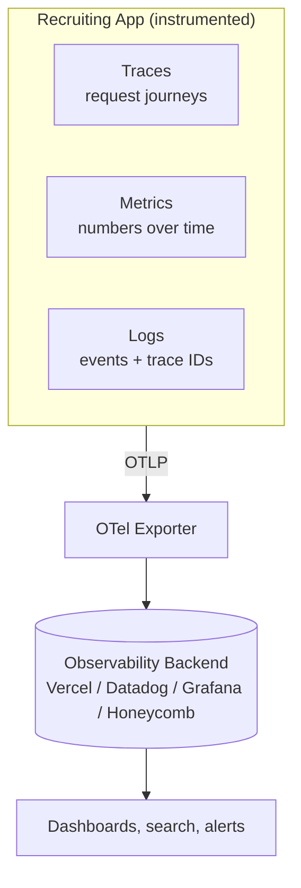
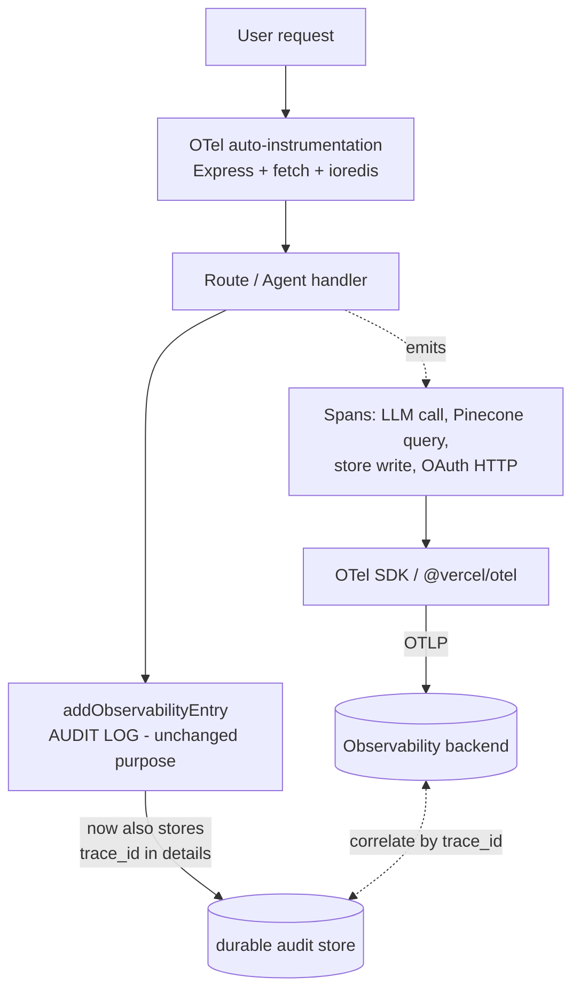

# OBS-001: Adding OpenTelemetry to the Recruiting Application

**Status:** Proposed | **Story:** REC-TBD | **Type:** Observability / Platform
**Created:** 2026-10-18 | **Audience:** Engineering, Product, Leadership (no prior telemetry knowledge assumed)

> **How to read this document.** Start with the **Executive Summary** (one page, no
> jargon). If a term is unfamiliar, jump to the **Dictionary of Terms**. The
> **Current State** and **The Gap** sections explain what we have and what hurts.
> The remaining sections are the technical proposal, roadmap, and risks.

---

## 1. Executive Summary

### The one-paragraph version
The Recruiting Application already records **what happened** — an "audit log" of
business events like *applicant registered* or *OAuth login failed*. It does **not**
record **how the system behaved** — how long requests took, where they slowed down,
which external service failed, or how much our AI features cost per request.
**OpenTelemetry (OTel)** is an industry-standard, vendor-neutral way to capture that
operational picture. Adding it would let us answer "why is this slow / why did this
fail?" in minutes instead of guessing, with especially high value for our AI/LLM and
social-login flows. It is **additive** — it sits alongside the existing audit log, not
in place of it.

### What we have vs. what we're missing

| Question | Can we answer it today? |
|---|---|
| "Did applicant X register successfully?" | ✅ Yes — the audit log records it. |
| "Why did the resume-parsing request take 11 seconds?" | ❌ No — we have no timing data. |
| "Is Google OAuth failing more than usual this hour?" | ❌ No — no error-rate metric. |
| "Which step is slow: the LLM call, the Pinecone search, or the database write?" | ❌ No — no end-to-end trace. |
| "How many OpenAI tokens (and how much cost) did this feature use today?" | ❌ No — not captured anywhere. |
| "When this request failed, what was the exact chain of calls behind it?" | ❌ No — events aren't linked together. |

### Why it matters for *this* product
This is an AI-heavy application: a single user action can trigger a LangChain/LangGraph
agent, one or more OpenAI/Anthropic LLM calls, a Pinecone vector search, a Redis lookup,
and external OAuth provider calls. These are the hardest things to debug and the most
expensive to run. OpenTelemetry makes each of those steps visible and measurable.

### The ask
Adopt OpenTelemetry in three phases (see §9). Phase 1 is roughly **half a day** of work
and delivers automatic request tracing with almost no code changes. Total effort to full
value is approximately **2–3 engineering days**, plus choosing a backend to view the data.

### What this is *not*
- It is **not** a replacement for the audit log (we keep that for compliance/history).
- It is **not** a specific vendor — OTel is an open standard; we can send data to Vercel,
  Datadog, Grafana, Honeycomb, or others, and switch later with a config change.
- It does **not**, by itself, fix the existing data-store persistence problem
  (see §8 and open bug **NFR-034**).

---

## 2. Dictionary of Terms

Plain-language definitions. Analogy in *italics*.

| Term | Definition |
|---|---|
| **Observability** | The ability to understand what's happening *inside* a system from the data it emits. *Like a car dashboard: speed, fuel, engine warnings.* |
| **Telemetry** | The signals a system emits about itself. The three OTel signals are **traces**, **metrics**, and **logs**. |
| **Audit log** (what we have) | A durable record of **business events** — who did what, to what, and whether it succeeded. *Like a visitor sign-in sheet.* It is **not** telemetry. |
| **OpenTelemetry (OTel)** | An open, vendor-neutral standard + set of libraries for generating and exporting telemetry. Backed by the CNCF (the same foundation behind Kubernetes). |
| **Signal** | A category of telemetry. OTel has three: **traces**, **metrics**, **logs**. |
| **Trace** | The full story of one request as it moves through the system, start to finish. *Like a package tracking history: every stop on the journey.* |
| **Span** | One step within a trace (e.g. "query Pinecone", "call OpenAI"). A trace is a tree of spans. Each span has a start time, duration, and status. |
| **Trace ID / Span ID** | Unique identifiers that link spans into one trace and let us correlate across services. |
| **Context propagation** | Passing the trace ID along as a request hops between functions/services, so all the spans join up into one trace. |
| **Metric** | A numeric measurement over time (e.g. requests per second, error rate, p95 latency, token count). *Like the needle on a gauge, sampled repeatedly.* |
| **Log** | A timestamped text/structured record of a discrete event. OTel logs can carry a trace ID so a log line links to its trace. |
| **Attribute** | A key/value tag on a span/metric/log (e.g. `http.method=GET`, `oauth.provider=google`, `llm.tokens=842`). Used for filtering and grouping. |
| **Resource** | Attributes describing *who is emitting* the data (e.g. `service.name=rec-app-build`, `deployment.environment=production`). |
| **Instrumentation** | The code that produces telemetry. **Auto-instrumentation** = libraries that add it for you (Express, HTTP, Redis). **Manual** = spans you add by hand for custom logic. |
| **Exporter** | The component that sends telemetry out of the app to a backend, usually over **OTLP**. |
| **OTLP** | *OpenTelemetry Protocol* — the standard wire format for shipping telemetry. One format, many compatible backends. |
| **Collector** | An optional standalone service that receives, processes (filters/batches/samples), and forwards telemetry. Useful at scale; optional for us early on. |
| **Backend / Observability platform** | Where telemetry is stored, searched, and visualized (Vercel Observability, Datadog, Grafana/Tempo, Honeycomb, etc.). |
| **Sampling** | Keeping only a representative fraction of traces to control cost/volume (e.g. 10%). |
| **Cardinality** | How many distinct values an attribute can take. High-cardinality tags (like raw user IDs on metrics) can blow up cost — a thing to design around. |
| **SLI / SLO** | *Service Level Indicator* (a measured number, e.g. p95 latency) / *Service Level Objective* (the target for it, e.g. "p95 < 500ms"). Metrics make these possible. |
| **p95 / p99 latency** | The response time under which 95% / 99% of requests complete. Far more useful than an average for spotting bad experiences. |

---

## 3. Current State — "Observability" in this repo today

What the codebase calls observability is an **application audit log**.

**Shape of a record** (`src/models/store.ts:133`):

```ts
interface ObservabilityLog {
  id: string;          // uuid
  timestamp: string;   // ISO time
  action: string;      // e.g. "oauth_login", "startup", "job_published"
  entityType: string;  // e.g. "Applicant", "System", "Job"
  entityId: string;
  userId: string;
  details: object;     // free-form payload
  outcome: 'success' | 'failure';
}
```

**How it is written** (`src/models/store.ts:262`): every event calls
`addObservabilityEntry`, which **reads the entire `data/observability.json` file,
appends one entry, and rewrites the whole file**. There are ~45 call sites across ~19
modules (routes, middleware, agents, services).

```
┌──────────────┐   addObservabilityEntry(entry)   ┌─────────────────────────┐
│ Route / Agent │ ───────────────────────────────▶ │ read observability.json │
│ (~45 sites)  │                                   │ push(entry)             │
└──────────────┘                                   │ write WHOLE file back   │
                                                     └─────────────┬───────────┘
                                                                   ▼
                                                     data/observability.json
                                                     (a growing JSON array)
```

**What this is good at:** a human-readable business/audit trail — "applicant 123 logged
in via Google at 10:04, success."

**What it cannot do:**
- No **durations** — nothing records how long anything took.
- No **traces** — the 45 events are independent; nothing links "login failed" to the
  specific downstream call that caused it.
- No **metrics** — no request rate, error rate, or latency percentiles.
- No **external visibility** — LLM calls, Pinecone queries, Redis, and OAuth provider
  HTTP calls emit nothing.
- No **query/dashboards/alerts** — it's a flat file, not a searchable backend.
- **Operational problems** (separate from this proposal): the full-file read-modify-write
  is O(n) per event, has no concurrency control, and does **not persist on Vercel's
  ephemeral serverless filesystem** (related to open blocker **NFR-034**).

---

## 4. The Gap — mapped to real pain


Every pink box above is an async, failure-prone, or billable step that today emits **zero
operational data**. When a user says "the app is slow" or "social login didn't work," an
engineer currently has no timing or trace data to localize the problem — only the
after-the-fact audit record that it failed.

Representative questions we cannot answer today, and the signal that would answer them:

| Pain | Signal that fixes it |
|---|---|
| "Resume parsing is sometimes slow." | **Trace** showing LLM vs. Pinecone vs. store time per request. |
| "Are OAuth logins degrading right now?" | **Metric**: `oauth_login` success/error rate over time, by provider. |
| "What's our OpenAI spend by feature?" | **Metric**: token counts tagged with the feature/route. |
| "This one request failed — show me everything it touched." | **Trace** + **logs** correlated by trace ID. |
| "Did the last deploy make p95 latency worse?" | **Metric**: latency percentiles before/after, as an SLO. |

---

## 5. What OpenTelemetry Is (for newcomers)

OpenTelemetry provides three kinds of signal and a standard way to ship them anywhere.



- **Traces** answer *where* time went and *what* failed in one request.
- **Metrics** answer *how much / how often / how fast* across many requests.
- **Logs** (optionally routed through OTel) carry the **trace ID** so a log line links to
  the exact trace it came from.

The key promise: **one standard format (OTLP), many interchangeable backends.** We
instrument once and can change where the data goes with configuration, never a rewrite.

---

## 6. Proposed Architecture — OTel *alongside* the audit log

OTel does not replace `ObservabilityLog`. We run both, and **link them with a trace ID**
so a business event can be opened directly into its operational trace.



**Design principles**
1. **Additive & non-breaking.** The 45 existing `addObservabilityEntry` call sites keep
   working. We only enrich `details` with the active `trace_id`.
2. **Auto first, manual where it pays.** Auto-instrument Express, outgoing HTTP/`fetch`,
   and `ioredis` for free coverage; add a few **manual spans/metrics** for the things
   auto-instrumentation can't know — LLM token counts, Pinecone query shape, agent steps.
3. **Vendor-neutral.** Export via OTLP; the backend choice is a deployment decision, not a
   code decision.
4. **Serverless-correct.** On Vercel, use `@vercel/otel` so spans are flushed before the
   function suspends (a naïve SDK setup drops spans on serverless).

### Mapping to this codebase

| Area | Code today | OTel treatment |
|---|---|---|
| HTTP routing | Express 5 (`src/index.ts`, `src/routes/*`) | **Auto** — one span per request, status + latency. |
| Outbound calls | `fetch` to OAuth providers (`src/services/oauthService.ts`) | **Auto** (fetch/http instrumentation) — spans for token exchange & userinfo. |
| LLM calls | `@langchain/openai`, `@langchain/anthropic` (`src/chains/*`, `src/routes/agents/*`) | **Manual** span per call + **metric** for token usage/cost, tagged by feature. |
| Vector search | `@pinecone-database/pinecone` (`src/services/vectorStore/pinecone.ts`) | **Manual** span: index, top-k, duration. |
| Cache/session | `ioredis` (OAuth state store) | **Auto** (ioredis instrumentation). |
| Agents | LangGraph scheduling agent (`src/agents/scheduling/agent.ts`) | **Manual** spans per graph node/step. |
| Audit events | `addObservabilityEntry` (45 sites) | **Unchanged** + inject `trace_id` into `details` for correlation. |
| Health | `/health` (`src/index.ts:41`) | Optional: expose readiness; keep out of latency SLOs. |

---

## 7. Benefits / ROI

- **Faster incident resolution.** Localize "slow/broken" to a specific span in one view
  instead of adding ad-hoc `console.log`s and redeploying.
- **Cost visibility for AI.** Token/cost metrics per feature are otherwise invisible; this
  is often the fastest-growing bill in an LLM product.
- **Proactive alerting & SLOs.** Define targets (e.g. "p95 login < 800ms", "OAuth error
  rate < 1%") and get paged before users complain.
- **Deploy safety.** Compare latency/error metrics before and after a release (directly
  relevant to the kind of Vercel runtime regressions seen in PR #11 / NFR-071).
- **No lock-in.** Standard format; switch or add backends without re-instrumenting.
- **Low ongoing cost to maintain.** Auto-instrumentation tracks framework upgrades.

---

## 8. Risks, Non-Goals, and Dependencies

**Non-goals (explicitly out of scope for OBS-001)**
- Replacing or redesigning the audit log. (It stays; we only add `trace_id`.)
- Fixing audit-log persistence on serverless — that is **NFR-034** and must be solved for
  the audit trail regardless of OTel.

**Risks & mitigations**
| Risk | Mitigation |
|---|---|
| Spans lost on Vercel serverless (function suspends before flush) | Use `@vercel/otel`, which handles flushing; verify in a preview deploy. |
| Telemetry cost / volume growth | Sampling (e.g. 10–20% of traces), keep high-cardinality values off metrics. |
| Leaking PII/secrets into span attributes | Attribute allow-list; never attach tokens, passwords, raw résumé text, or full emails. Mirrors existing security posture (see security feature SEC-OAUTH-001). |
| "We have data but no destination" | Phase 1 includes selecting and wiring exactly one backend before declaring value. |
| Performance overhead | Minimal with batching + sampling; validate with a before/after latency check. |

**Dependencies**
- A chosen observability backend / OTLP endpoint (decision needed — see Appendix B).
- Deploy target: Vercel (Node runtime on Fluid Compute) → `@vercel/otel`.
- Env vars for the exporter endpoint + headers (managed like other secrets).

---

## 9. Phased Implementation Roadmap (with sizing)

Sizing legend (shared with `docs/features/security/`): **XS** <1h · **S** 1–3h ·
**M** 3–6h (½ day) · **L** 1–2 days.

| Phase | Deliverable | Size | Outcome |
|---|---|---|---|
| **P1 — Baseline tracing** | Add `@vercel/otel` + Node auto-instrumentations (Express, fetch, ioredis); pick one backend; verify traces appear from a preview deploy. | **M** | Every request traced automatically, incl. OAuth provider calls — near-zero code. |
| **P2 — AI & custom spans/metrics** | Manual spans for LLM calls, Pinecone queries, and LangGraph agent steps; token-usage/cost metric tagged by feature. | **M** | The pink boxes in §4 become visible and measurable; AI cost tracked. |
| **P3 — Correlation, SLOs & guardrails** | Inject `trace_id` into `ObservabilityLog.details`; define 3–5 SLOs + alerts; set sampling; add a PII attribute allow-list; document runbook. | **M** | Audit ↔ trace correlation, alerting, and safe, cost-controlled steady state. |

**Total:** ~**3 M-sized phases ≈ 2–3 engineering days**, plus the backend decision.
Each phase is independently shippable and delivers value on its own.

### Acceptance criteria (per phase)
- **P1:** A real request to a preview deployment produces a trace in the backend with
  spans for the Express handler and any outbound HTTP; p95/error-rate metrics populate.
- **P2:** A resume-parse or match request shows distinct LLM, Pinecone, and store spans
  with durations; a token-usage metric is queryable by feature/route.
- **P3:** An audit entry's `details.trace_id` opens the corresponding trace; at least
  three SLOs have alerts; sampling and an attribute allow-list are in place and documented.

---

## 10. Appendix

### Appendix A — Example: one traced request (illustrative)

```
Trace: POST /api/agents/communication/generate        total 1.84s   status OK
├─ span  express.request                               1.84s
│  ├─ span  agent.candidateCommunication               1.79s
│  │  ├─ span  llm.openai.chat  (model=gpt-4o)          1.21s   tokens.in=612 tokens.out=230
│  │  └─ span  store.write (observability)             0.04s
│  └─ span  http.fetch  (provider userinfo)            0.31s   http.status=200
```
*Reading it:* the LLM call dominates (1.21s of 1.84s) — the obvious optimization target.
None of this timing exists today.

### Appendix B — Backend options (decision aid)

| Backend | Why consider | Notes |
|---|---|---|
| **Vercel Observability / OTel** | Native to our deploy target; least setup | Good default for P1. |
| **Datadog** | Rich APM; a Datadog integration is already available to the team | Paid; strong dashboards/alerting. |
| **Grafana Cloud (Tempo/Mimir/Loki)** | Open-source stack; cost-effective | More setup. |
| **Honeycomb** | Excellent high-cardinality trace exploration | Paid; great for debugging. |

All speak OTLP, so the choice does not change application code — only exporter config.

### Appendix C — Minimal P1 shape (illustrative, not final)

```ts
// instrumentation.ts  (loaded before app code; Vercel convention)
import { registerOTel } from '@vercel/otel';
registerOTel({ serviceName: 'rec-app-build' });
// Auto-instruments Express, fetch, and more; exporter endpoint via env (OTLP).
```

```ts
// Manual LLM span + token metric (Phase 2 sketch)
await tracer.startActiveSpan('llm.openai.chat', async (span) => {
  span.setAttribute('llm.model', model);
  const res = await chat.invoke(messages);
  span.setAttribute('llm.tokens.total', res.usage?.total_tokens ?? 0);
  tokenCounter.add(res.usage?.total_tokens ?? 0, { feature: 'candidate_communication' });
  span.end();
  return res;
});
```

### Appendix D — References
- OpenTelemetry docs: https://opentelemetry.io/docs/
- OTel JS / Node: https://opentelemetry.io/docs/languages/js/
- `@vercel/otel`: https://vercel.com/docs/observability/otel-overview
- OTLP spec: https://opentelemetry.io/docs/specs/otlp/
- Related internal docs: `docs/features/README.md`, `docs/features/security/feature-oauth-security-hardening.md`, `BUGS.md` (NFR-034 data-store persistence)

---

## Related tracking
- Proposes new work; suggested tracking ID **NFR-079** (next free ID) once accepted.
- **NFR-034** (JSON data-store persistence on serverless) is a prerequisite for *audit-log*
  durability but **independent** of OTel telemetry — do not conflate them.
