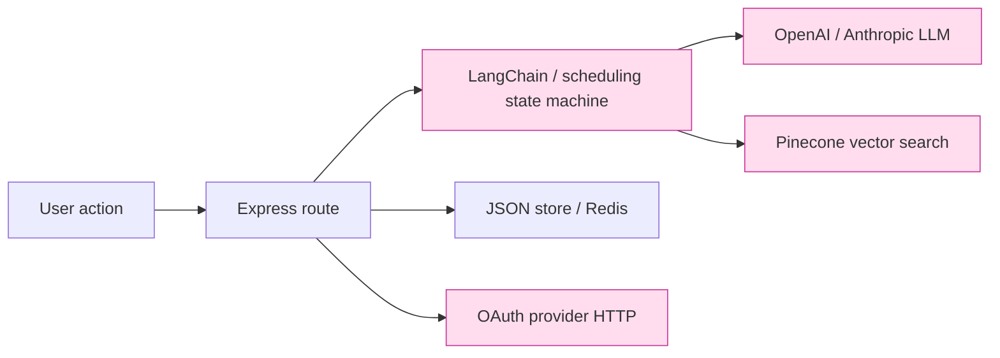
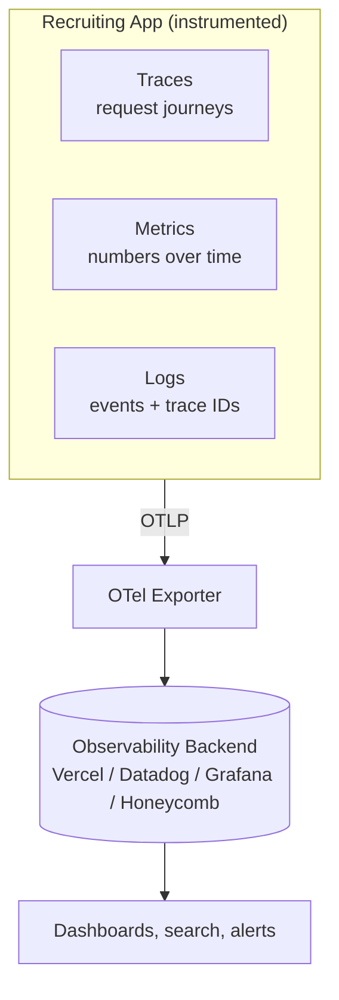
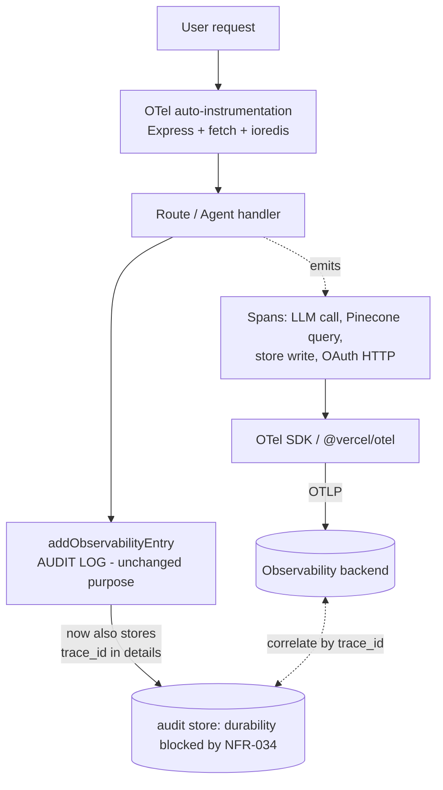

# OBS-001: Adding OpenTelemetry to the Recruiting Application

**Status:** Proposed — expanded into three delivery features | **Initiative:** OBS-001 | **Type:** Observability / Platform
**Created:** 2026-10-18 | **Audience:** Engineering, Product, Leadership (no prior telemetry knowledge assumed)

> **Review update (2026-10-18):** The [detailed review](review-opentelemetry-proposal.md),
> [three-feature backlog and decision register](README.md), and [prioritized stories](../../stories/observability/README.md)
> are the delivery specification. The user confirmed all three external-visibility categories:
> provider calls, independent uptime/browser monitoring, and customer-facing status.
> Platform, budgets, retention/residency, SLO targets and named owners remain gated decisions.
> This proposal is not evidence of implementation.
>
> **How to read this document.** Start with the **Executive Summary** (one page, no
> jargon). If a term is unfamiliar, jump to the **Dictionary of Terms**. The
> **Current State** and **The Gap** sections explain what we have and what hurts.
> The remaining sections are the technical proposal, roadmap, and risks.

---

## 1. Executive Summary

### The one-paragraph version
The Recruiting Application already records **what happened** — an "audit log" of
business events like *applicant registered* or *OAuth login failed*. It does **not**
record **how the system behaved** — how long requests took, where they slowed down,
which external service failed, or how much our AI features cost per request.
**OpenTelemetry (OTel)** is an industry-standard, vendor-neutral way to capture that
operational picture. Adding it would let us answer "why is this slow / why did this
fail?" in minutes instead of guessing, with especially high value for our AI/LLM and
social-login flows. It is **additive** — it sits alongside the existing audit log, not
in place of it.

### What we have vs. what we're missing

| Question | Can we answer it today? |
|---|---|
| "Did applicant X register successfully?" | ✅ Yes — the audit log records it. |
| "Why did the resume-parsing request take 11 seconds?" | ❌ No — we have no timing data. |
| "Is Google OAuth failing more than usual this hour?" | ❌ No — no error-rate metric. |
| "Which step is slow: the LLM call, the Pinecone search, or the database write?" | ❌ No — no end-to-end trace. |
| "How many OpenAI tokens (and how much cost) did this feature use today?" | ❌ No — not captured anywhere. |
| "When this request failed, what was the exact chain of calls behind it?" | ❌ No — events aren't linked together. |

### Why it matters for *this* product
This is an AI-heavy application: a single user action can trigger a LangChain chain or scheduling
state machine, one or more OpenAI/Anthropic LLM calls, a Pinecone vector search, a Redis lookup,
and external OAuth provider calls. These are the hardest things to debug and the most
expensive to run. OpenTelemetry makes each of those steps visible and measurable.

### The ask
Adopt OpenTelemetry in three phases (see §9), with explicit request metrics, safe
logging and export validation as well as traces. The original half-day-per-phase /
2–3 day estimate is withdrawn for the expanded scope. Size the prioritized stories after
backend/runtime spikes, separating engineering effort from approvals, provisioning,
baseline collection and operational validation.

### What this is *not*
- It is **not** a replacement for the audit log (we keep that for compliance/history).
- It is **not** a specific vendor — OTel is an open standard; we can send data to Vercel,
  Datadog, Grafana, Honeycomb, or others, and switch later with a config change.
- It does **not**, by itself, fix the existing data-store persistence problem
  (see §8 and open bug **NFR-034**).

---

## 2. Dictionary of Terms

Plain-language definitions. Analogy in *italics*.

| Term | Definition |
|---|---|
| **Observability** | The ability to understand what's happening *inside* a system from the data it emits. *Like a car dashboard: speed, fuel, engine warnings.* |
| **Telemetry** | The signals a system emits about itself. The three OTel signals are **traces**, **metrics**, and **logs**. |
| **Audit log** (what we have) | A durable record of **business events** — who did what, to what, and whether it succeeded. *Like a visitor sign-in sheet.* It is **not** telemetry. |
| **OpenTelemetry (OTel)** | An open, vendor-neutral standard + set of libraries for generating and exporting telemetry. Backed by the CNCF (the same foundation behind Kubernetes). |
| **Signal** | A category of telemetry. OTel has three: **traces**, **metrics**, **logs**. |
| **Trace** | The full story of one request as it moves through the system, start to finish. *Like a package tracking history: every stop on the journey.* |
| **Span** | One step within a trace (e.g. "query Pinecone", "call OpenAI"). A trace is a tree of spans. Each span has a start time, duration, and status. |
| **Trace ID / Span ID** | Unique identifiers that link spans into one trace and let us correlate across services. |
| **Context propagation** | Passing the trace ID along as a request hops between functions/services, so all the spans join up into one trace. |
| **Metric** | A numeric measurement over time (e.g. requests per second, error rate, p95 latency, token count). *Like the needle on a gauge, sampled repeatedly.* |
| **Log** | A timestamped text/structured record of a discrete event. OTel logs can carry a trace ID so a log line links to its trace. |
| **Attribute** | A key/value tag on a span/metric/log (e.g. `http.method=GET`, `oauth.provider=google`, `llm.tokens=842`). Used for filtering and grouping. |
| **Resource** | Attributes describing *who is emitting* the data (e.g. `service.name=rec-app-build`, `deployment.environment=production`). |
| **Instrumentation** | The code that produces telemetry. **Auto-instrumentation** = libraries that add it for you (Express, HTTP, Redis). **Manual** = spans you add by hand for custom logic. |
| **Exporter** | The component that sends telemetry out of the app to a backend, usually over **OTLP**. |
| **OTLP** | *OpenTelemetry Protocol* — the standard wire format for shipping telemetry. One format, many compatible backends. |
| **Collector** | An optional standalone service that receives, processes (filters/batches/samples), and forwards telemetry. Useful at scale; optional for us early on. |
| **Backend / Observability platform** | Where telemetry is stored, searched, and visualized (Vercel Observability, Datadog, Grafana/Tempo, Honeycomb, etc.). |
| **Sampling** | Keeping only a representative fraction of traces to control cost/volume (e.g. 10%). |
| **Cardinality** | How many distinct values an attribute can take. High-cardinality tags (like raw user IDs on metrics) can blow up cost — a thing to design around. |
| **SLI / SLO** | *Service Level Indicator* (a measured number, e.g. p95 latency) / *Service Level Objective* (the target for it, e.g. "p95 < 500ms"). Metrics make these possible. |
| **p95 / p99 latency** | The response time under which 95% / 99% of requests complete. Far more useful than an average for spotting bad experiences. |

---

## 3. Current State — "Observability" in this repo today

What the codebase calls observability is an **application audit log**.

**Shape of a record** (`src/models/store.ts:133`):

```ts
interface ObservabilityLog {
  id: string;          // uuid
  timestamp: string;   // ISO time
  action: string;      // e.g. "oauth_login", "startup", "job_published"
  entityType: string;  // e.g. "Applicant", "System", "Job"
  entityId: string;
  userId: string;
  details: object;     // free-form payload
  outcome: 'success' | 'failure';
}
```

**How it is written** (`src/models/store.ts:262`): every event calls
`addObservabilityEntry`, which **reads the entire `data/observability.json` file,
appends one entry, and rewrites the whole file**. There are ~45 call sites across ~19
modules (routes, middleware, agents, services).

```
┌──────────────┐   addObservabilityEntry(entry)   ┌─────────────────────────┐
│ Route / Agent │ ───────────────────────────────▶ │ read observability.json │
│ (~45 sites)  │                                   │ push(entry)             │
└──────────────┘                                   │ write WHOLE file back   │
                                                     └─────────────┬───────────┘
                                                                   ▼
                                                     data/observability.json
                                                     (JSON object with logs array)
```

**What this is good at:** a human-readable business/audit trail — "applicant 123 logged
in via Google at 10:04, success."

**What it cannot do:**
- No **durations** — nothing records how long anything took.
- No **traces** — the 45 events are independent; nothing links "login failed" to the
  specific downstream call that caused it.
- No **metrics** — no request rate, error rate, or latency percentiles.
- No **external visibility** — LLM calls, Pinecone queries, Redis, and OAuth provider
  HTTP calls emit nothing.
- No **query/dashboards/alerts** — it's a flat file, not a searchable backend.
- **Operational problems** (separate from this proposal): the full-file read-modify-write
  is O(n) per event, has no concurrency control, and does **not persist on Vercel's
  ephemeral serverless filesystem** (related to open blocker **NFR-034**).

---

## 4. The Gap — mapped to real pain



Every pink box above is an async, failure-prone, or billable step that today emits **zero
operational data**. When a user says "the app is slow" or "social login didn't work," an
engineer currently has no timing or trace data to localize the problem — only the
after-the-fact audit record that it failed.

Representative questions we cannot answer today, and the signal that would answer them:

| Pain | Signal that fixes it |
|---|---|
| "Resume parsing is sometimes slow." | **Trace** showing LLM vs. Pinecone vs. store time per request. |
| "Are OAuth logins degrading right now?" | **Metric**: `oauth_login` success/error rate over time, by provider. |
| "What's our OpenAI spend by feature?" | **Metric**: token counts tagged with the feature/route. |
| "This one request failed — show me everything it touched." | **Trace** + **logs** correlated by trace ID. |
| "Did the last deploy make p95 latency worse?" | **Metric**: latency percentiles before/after, as an SLO. |

---

## 5. What OpenTelemetry Is (for newcomers)

OpenTelemetry provides three kinds of signal and a standard way to ship them anywhere.



- **Traces** answer *where* time went and *what* failed in one request.
- **Metrics** answer *how much / how often / how fast* across many requests.
- **Logs** (optionally routed through OTel) carry the **trace ID** so a log line links to
  the exact trace it came from.

The key promise: **standard instrumentation and export reduce backend coupling.**
Signal support and backend-specific dashboards, alerting and policies still require
validation and migration work.

---

## 6. Proposed Architecture — OTel *alongside* the audit log

OTel does not replace `ObservabilityLog`. We run both, and **link them with a trace ID**
so a business event can be opened directly into its operational trace.



**Design principles**
1. **Additive & non-breaking.** The existing `addObservabilityEntry` call sites keep
   working. We only enrich `details` with the active `trace_id`.
2. **Auto first, manual where it pays.** Verify compatible instrumentation for Express, outgoing HTTP/`fetch`,
   and `ioredis` against the actual runtime; add a few **manual spans/metrics** for the things
   auto-instrumentation can't know — LLM token counts, Pinecone query shape, agent steps.
3. **Vendor-neutral.** Prefer OTLP for portability. Signal support, queries, dashboards, alerts,
   retention and access controls still require backend-specific configuration and validation.
4. **Serverless-correct.** Evaluate `@vercel/otel` against the actual Express/ESM deployment entrypoint;
   prove cold/warm delivery, bounded flushing and failure behavior. Package selection alone
   is not a guarantee against span or metric loss.

### Mapping to this codebase

| Area | Code today | OTel treatment |
|---|---|---|
| HTTP routing | Express 5 (`src/index.ts`, `src/routes/*`) | **Auto** — one span per request, status + latency. |
| Outbound calls | `fetch` to OAuth providers (`src/services/oauthService.ts`) | **Auto** (fetch/http instrumentation) — spans for token exchange & userinfo. |
| LLM calls | `@langchain/openai`, `@langchain/anthropic` (`src/chains/*`, `src/routes/agents/*`) | **Manual** span per call + **metric** for token usage/cost, tagged by feature. |
| Vector search | `@pinecone-database/pinecone` (`src/services/vectorStore/pinecone.ts`) | **Manual** span: index, top-k, duration. |
| Cache/session | `ioredis` (OAuth state store) | **Auto** (ioredis instrumentation). |
| Agents | Custom scheduling state machine (`src/agents/scheduling/agent.ts`) | **Manual** spans per actual state-machine step; label simulated integrations. |
| Audit events | `addObservabilityEntry` (45 sites) | **Unchanged** + inject `trace_id` into `details` for correlation. |
| Health | `/health` (`src/index.ts:41`) | Optional: expose readiness; keep out of latency SLOs. |

---

## 7. Benefits / ROI

- **Faster incident resolution.** Localize "slow/broken" to a specific span in one view
  instead of adding ad-hoc `console.log`s and redeploying.
- **Cost visibility for AI.** Token/cost metrics per feature are otherwise invisible; this
  is often the fastest-growing bill in an LLM product.
- **Proactive alerting & SLOs.** Define targets (e.g. "p95 login < 800ms", "OAuth error
  rate < 1%") and get paged before users complain.
- **Deploy safety.** Compare latency/error metrics before and after a release (directly
  relevant to the kind of Vercel runtime regressions seen in PR #11 / NFR-071).
- **No lock-in.** Standard APIs reduce instrumentation coupling; backend queries, access, alerts and retention still need migration validation.
- **Low ongoing cost to maintain.** Instrumentation compatibility is revalidated when framework/SDK versions change.

---

## 8. Risks, Non-Goals, and Dependencies

**Non-goals (explicitly out of scope for OBS-001)**
- Replacing or redesigning the audit log. (It stays; we only add `trace_id`.)
- Fixing audit-log persistence on serverless — that is **NFR-034** and must be solved for
  the audit trail regardless of OTel.

**Risks & mitigations**
| Risk | Mitigation |
|---|---|
| Spans lost on Vercel serverless (function suspends before flush) | Validate the chosen SDK/runtime lifecycle with cold/warm and exporter-failure tests in preview. |
| Telemetry cost / volume growth | Sampling (e.g. 10–20% of traces), keep high-cardinality values off metrics. |
| Leaking PII/secrets into span attributes | P1 attribute allow-list before any export; sanitize automatic spans, exceptions and diagnostics, including model output embedded in parsing errors. The originally cited security feature path is absent in this checkout. |
| "We have data but no destination" | Phase 1 includes selecting and wiring exactly one backend before declaring value. |
| Performance overhead | Minimal with batching + sampling; validate with a before/after latency check. |

**Dependencies**
- A chosen observability backend / OTLP endpoint (decision needed — see Appendix B).
- Intended deploy target: Vercel; actual runtime/entrypoint and SDK compatibility must be verified by OBS-P1-S03.
- Env vars for the exporter endpoint + headers (managed like other secrets).

---

## 9. Phased implementation roadmap and acceptance

The phases retain the original intent. Privacy controls move to P1 because export
must be safe from the first signal. P3 hardens governance and adds the user-confirmed
external and customer-facing operational scope. Every linked feature maps its ACs to
prioritized stories with verification evidence and explicit release gates.

| Phase | Feature | Required outcome |
|---|---|---|
| P1 — Baseline tracing | [OBS-001-P1](feature-observability-p1-baseline-tracing.md) | Real preview request/HTTP/Redis traces; full-population p95/error-rate metrics; safe logs; runtime visibility; proven export reliability. |
| P2 — AI & custom spans/metrics | [OBS-001-P2](feature-observability-p2-ai-custom-telemetry.md) | Actual LLM/embedding, Pinecone, store and workflow timings/outcomes; feature token usage and estimated cost with explicit completeness. |
| P3 — Correlation, SLOs & guardrails | [OBS-001-P3](feature-observability-p3-operational-readiness.md) | Safe audit correlation; at least three approved SLOs with tested alerts; sampling/governance; independent uptime/browser checks; customer status and incident readiness. |

### Acceptance refinements

- **P1:** A real preview request produces a correctly parented trace for the actual
  Express handler and outbound calls. Request p95/error-rate metrics populate from
  a verified metrics pipeline independent of trace sampling. Privacy and delivery
  gates must pass before release.
- **P2:** Real resume-parse/matching fixtures collectively show distinct LLM/embedding,
  Pinecone and store spans with durations; no fictitious call is inserted to force
  all components into one request. Tokens are queryable by feature/route mapping;
  missing usage is unknown, not zero. Cost estimates expose price/usage coverage.
- **P3:** An audit entry's `details.trace_id` resolves its retained trace for authorized
  users; unsampled, expired or unavailable traces have an explicit fallback. At least
  three SLOs have approved targets and tested alerts/runbooks. Sampling, privacy,
  retention, external probes and customer status meet the linked feature criteria.

No delivery estimate is committed. [D01–D15](README.md#decision-register-and-release-gates)
record decisions and the specific releases they block. All stories remain Proposed.
NFR-034 remains an independent blocker for production mutation and audit durability.

---

## 10. Appendix

### Appendix A — Example: one traced request (illustrative)

```
Trace: POST /api/agents/communication/generate        total 1.84s   status OK
├─ span  express.request                               1.84s
│  ├─ span  agent.candidateCommunication               1.79s
│  │  ├─ span  llm.openai.chat  (model=gpt-4o)          1.21s   tokens.in=612 tokens.out=230
│  │  └─ span  store.write (observability)             0.04s
│  └─ span  http.fetch  (provider userinfo)            0.31s   http.status=200
```
*Reading it:* this is an illustration, not a verified route call tree; communication
generation is not asserted to call OAuth userinfo. Inclusive and overlapping child
span durations must not be summed as elapsed time. Actual paths are mapped by OBS-P2-S01.

### Appendix B — Backend options (decision aid)

| Backend | Why consider | Notes |
|---|---|---|
| **Vercel Observability / OTel** | Candidate aligned to intended hosting | Verify plan, supported signals, querying, alerting and retention; not preselected. |
| **Datadog** | Candidate APM platform; account/entitlement unverified | Paid; strong dashboards/alerting. |
| **Grafana Cloud (Tempo/Mimir/Loki)** | Open-source stack; cost-effective | More setup. |
| **Honeycomb** | Excellent high-cardinality trace exploration | Paid; great for debugging. |

OTLP can reduce instrumentation coupling. OBS-P1-S01 must verify signal-specific
support, plan entitlement, ingest authentication, query/dashboards, alerts and cost.
Switching backend is not assumed to be an exporter-only change.

### Appendix C — Implementation safeguards

The former minimal snippets are intentionally removed: they implied that a filename
alone initializes this Express/ESM app, treated missing token usage as zero, and ended
spans only on success. Use the acceptance contracts in OBS-P1-S03, OBS-P2-S02 and
OBS-P2-S04 instead. Initialization must precede dependency loading in the actual
runtime; spans must end on success/error/cancellation; missing usage remains unknown;
automatic exception recording must not leak model output.

### Appendix D — References
- OpenTelemetry docs: https://opentelemetry.io/docs/
- OTel JS / Node: https://opentelemetry.io/docs/languages/js/
- `@vercel/otel`: https://vercel.com/docs/tracing/instrumentation
- OTLP spec: https://opentelemetry.io/docs/specs/otlp/
- Related internal docs: [feature index](../README.md), [decision and story index](README.md), [NFR-034 in BUGS.md](../../../BUGS.md). The originally referenced security feature file is absent in this checkout.

---

## Related tracking
- Work is tracked locally as **OBS-001-P1/P2/P3** with stable **OBS-Px-Snn** story IDs. No external issue or NFR number is reserved by this document.
- **NFR-034** (JSON data-store persistence on serverless) is a prerequisite for *audit-log*
  durability but **independent** of OTel telemetry — do not conflate them.
