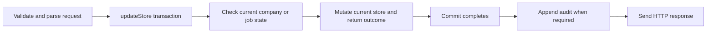

# Feature: Repair PostgreSQL Company and Job Write Paths

**Feature ID:** NFR-DATA-002  
**Status:** Implementation complete; local and hosted PostgreSQL CI passed (2026-10-26); merged in PR #24; open: reviewer sign-off, missing-ID DELETE status, hosted production durability
**Priority:** Critical  
**Size:** L overall — 3 stories (M + L + M), about 2–3 working days  
**Parent:** [Durable PostgreSQL Application Storage](feature-durable-postgresql-storage.md)  
**Tracks:** NFR-034, NFR-064, NFR-065, NFR-067  
**Decision:** Migrate the remaining company and job handlers to the existing atomic `updateStore` API. Do not make `writeStore` accept PostgreSQL snapshots.

## Objective and outcome

Recruiting staff must be able to create, update, import, and delete companies and jobs when PostgreSQL is configured. Today, those routes read a detached `DataStore`, mutate it, and call `writeStore`. The PostgreSQL backend intentionally throws `LegacyWholesaleWriteError` for that API. The first company create in the database CI flow returns HTTP 500, so later tests run without the company, job, applicant, and application IDs they expect.

The outcome is that every successful company or job mutation commits through `updateStore`, a failed mutation leaves the database unchanged, and the real PostgreSQL CI gate passes without disabling the legacy-write guard. The feature closes a gap in the parent storage feature; it does not introduce a new persistence backend.

### Evidence and current failure

- [PostgreSQL CI run on the applicant PR](https://github.com/jbaker7989/RecruitingApp/actions/runs/40273491051/job/121411205541) passed PostgreSQL readiness, typecheck, lint, and build. `npm run test:db` reported 13 pass, 5 fail, and 2 skipped; the built-artifact smoke step did not run.
- The first failing assertion is `POST /api/companies`: actual 500, expected 201, with `writeStore() is not supported with the database backend; use updateStore()` in the response. The [earlier main run](https://github.com/jbaker7989/RecruitingApp/actions/runs/40003304710) had the same five failing tests and first error.
- The four later failures depend on IDs assigned only after the first test advances. They are best treated as cascades until the setup succeeds and the tests can exercise their intended behavior. A green JSON-mode `npm test` does not prove these PostgreSQL routes work.
- [Lead developer review](../../review-artifacts/PostgreSQL_CI_Failure_Review.docx) records the failure chain and the two considered options.

## Scope and capability boundaries

| Capability | Included behavior | Current call sites | Story |
|---|---|---|---|
| Company writes | Create, update, delete, including hiring-manager association on create | `src/routes/companies.ts`: three `writeStore` calls | [NFR-DATA-002-S01](../../stories/platform/story-postgresql-company-writes.md) |
| Job writes | Create, bulk import, update, delete | `src/routes/jobs.ts`: four `writeStore` calls | [NFR-DATA-002-S02](../../stories/platform/story-postgresql-job-writes.md) |
| Database proof | Isolated route coverage, repaired acceptance fixtures, full PostgreSQL and JSON gates | `tests/integration/database*.test.ts`, existing CI workflow | [NFR-DATA-002-S03](../../stories/platform/story-postgresql-write-path-verification.md) |

The capabilities share one storage contract and can be reviewed separately. S01 precedes the complete end-to-end flow because a job needs a company. S02 can be developed after the contract is understood, while S03 adds focused tests before and during both migrations and finishes with the full gate.

### In scope

- Replace all seven production `writeStore` call sites in company and job routes with `updateStore` mutations.
- Recheck existence and relationships against the latest store state **inside** each mutator. Keep input parsing and other non-store work outside it.
- Preserve endpoint authorization, response status and shape, default values, route ordering, and existing per-row import result semantics unless a test proves an existing behavior incompatible with atomic commit. Record any intentional change before implementation.
- Ensure the company creation and hiring-manager link commit together. Ensure each job import persists its successful rows in one store transaction, and report counts only after commit.
- Keep audit appends after a successful commit through `addObservabilityEntry`; do not write `store.observability` in a mutator.
- Add real PostgreSQL tests that prove each route persisted or rolled back as expected, repair the shared fixture dependency that causes misleading cascading failures, and retain JSON-mode regression coverage.

### Out of scope

- Implementing targeted SQL repositories or changing the PostgreSQL schema, indexes, advisory locking, or migration format.
- Making `writeStore` work in PostgreSQL, adding JSON fallback when a configured database fails, or weakening/skipping database CI.
- Changing company/job role policy, job validation rules, mass-assignment policy, company deletion relationships, or import product semantics except where required to preserve the existing contract under atomic persistence. Capture those as separate work if found.
- Production deployment or hosted durability certification; local and CI proof are required here, hosted evidence remains a parent-feature release gate.

## Technical contract and architecture

`readStore()` returns a snapshot and mutating it does not persist. `updateStore(mutator)` loads the latest state under the database writer lock, runs the mutator, commits only changed records, and returns after commit. A thrown mutator or failed database write rolls back. A mutator must not call any store API, perform network or CPU-heavy work, append an audit record, or send an HTTP response. These rules come from [the storage contract](../../implementation/db-storage-contract.md).



Representative pattern; it is illustrative rather than a new helper API:

```ts
const outcome = await updateStore(store => {
  const index = store.companies.findIndex(item => item.id === companyId);
  if (index === -1) return { kind: 'not-found' as const };
  store.companies[index] = { ...store.companies[index], companyName, updatedAt };
  return { kind: 'updated' as const, company: store.companies[index] };
});
if (outcome.kind === 'not-found') return res.status(404).json({ error: 'Company not found' });
return res.json(outcome.company);
```

The actual implementation must construct the existing fields and compute `updatedAt` outside the mutator as appropriate. For update/delete, return `not-found` before changing the store. For import, parse rows and build candidate records outside the mutator, check the company inside it, push the successful candidates together, and report success only when commit resolves. If the commit fails, no success response or success audit may be emitted.

## SDD specification

### Technology and project structure

- Node 24, TypeScript, Express 5, `pg` 8; the `src/models/store.ts` facade selects JSON or PostgreSQL at runtime.
- Production changes belong in `src/routes/companies.ts` and `src/routes/jobs.ts`; avoid a new abstraction unless the repeated route logic requires one.
- PostgreSQL integration tests belong in `tests/integration/database*.test.ts` and run with an isolated `DATABASE_SCHEMA`. JSON regressions remain under `tests/**/*.test.ts`.
- The existing workflow is `.github/workflows/database-ci.yml`; its PostgreSQL service and `DB_TEST_REQUIRED=true` are required behavior.

### Commands

```bash
npm ci
npm run typecheck
npm run lint
npm run build
npm test
# With a disposable PostgreSQL service, DATABASE_URL, USE_DATABASE=true,
# DB_TEST_REQUIRED=true, NODE_ENV=test, and an isolated DATABASE_SCHEMA:
npm run test:db
# Run the existing built-artifact smoke step against PostgreSQL after test:db:
npm run smoke
```

### Testing strategy

Write a failing real-PostgreSQL test for each affected route or route family before changing the handler. Assert both HTTP behavior and a fresh `readStore()` result. For failed validation, missing parent records, and forced database failures, assert that no partial row or success audit remains. Cover concurrent independent writes and the hiring-manager/company link. Use synthetic applicants and companies only. Make the password-reset rollback test independent of the prior end-to-end flow so a company failure cannot turn it into a misleading `no_applicant` result.

### Boundaries

- **Always:** Preserve the storage contract, validate current state inside mutators, keep network/HTTP/audit work outside mutators, and run JSON plus real PostgreSQL tests.
- **Require separate design review before adding:** schema changes, new dependencies, altered endpoint or import semantics, or a new persistence abstraction.
- **Never:** Catch a database write failure and return success, restore PostgreSQL `writeStore`, suppress the CI failure, use production data in tests, or treat a skipped PostgreSQL suite as a pass.

## Feature acceptance criteria

- **F-AC1:** Company create, update, and delete work with `USE_DATABASE=true`, preserve current HTTP behavior, and persist correct rows. Hiring-manager association is committed with company creation.
- **F-AC2:** Job create, import, update, and delete work with `USE_DATABASE=true`, preserve current HTTP behavior and import result semantics, and persist correct rows.
- **F-AC3:** All seven route `writeStore` calls are gone. `writeStore` still rejects PostgreSQL snapshots in a direct contract test.
- **F-AC4:** Missing company/job targets produce the existing not-found response with no partial mutation. Failed database commits produce no success response or success audit; previously committed unrelated data remains intact.
- **F-AC5:** The database acceptance suite has independent prerequisites for tests that can run separately. Its reset-token rollback test reaches the intended applicant row and trigger. No failure is misreported as success through shared empty IDs.
- **F-AC6:** The required real PostgreSQL CI job passes `test:db` and its built-artifact smoke step on the same revision. Typecheck, lint, build, and `npm test` pass. `DB_TEST_REQUIRED=true` still fails if PostgreSQL is unavailable.

## Implementation plan and checkpoints

1. **Contract and baseline:** Record the known failing database assertions, inspect all seven callers, and add focused PostgreSQL tests that fail for the expected unsupported-write reason. Confirm JSON behavior to preserve.
2. **S01 company slice:** Convert create, then update/delete. Verify each route against PostgreSQL and JSON; rerun the end-to-end acceptance setup to confirm company creation now succeeds.
3. **S02 job slice:** Convert create, import, update/delete. Verify parent checks, persisted rows, concurrent writes, import counts, and successful audit ordering.
4. **S03 suite and CI:** Isolate dependent fixtures, run the complete database gate and smoke, then typecheck, lint, build, and full JSON suite. Investigate any new failures revealed after the first blocker is removed.

Checkpoint A is a committed company slice with its focused tests green. Checkpoint B is a committed job slice with its focused tests green. Completion requires F-AC1 through F-AC6 and a green hosted CI run; no local-only result closes F-AC6.

## Story and task ledger

| Order | Story | Priority | Size | Main deliverable | Verification |
|---|---|---|---|---|---|
| 1 | [S01 Company writes](../../stories/platform/story-postgresql-company-writes.md) | Critical (P1) | M (3–6h) | Three company handlers use `updateStore` | Focused PostgreSQL and JSON company tests |
| 2 | [S02 Job writes](../../stories/platform/story-postgresql-job-writes.md) | Critical (P2) | L (1–2 days) | Four job handlers use `updateStore` | Focused PostgreSQL and JSON job tests |
| 3 | [S03 Verification](../../stories/platform/story-postgresql-write-path-verification.md) | Critical (P3) | M (3–6h) | Isolated fixtures and full gate evidence | `test:db`, smoke, full suite, CI run |

**Total estimate:** roughly 2–3 working days of implementation and verification for one developer, excluding review wait time and any defects revealed once the first blocker is removed. Sizes follow the T-shirt legend in [security features](../security/README.md#sizing-legend) (XS < 1h, S 1–3h, M 3–6h, L 1–2 days). All three stories are Critical because the required database CI gate is red; P1–P3 is execution order.

## Risks and open questions

- **Hidden defects after setup:** The current first failure prevents downstream flows from running. Treat new failures after S01/S02 as real findings and update the story ledger, not as proof that the repair failed conceptually.
- **Import behavior:** Confirm whether the current per-row failure report is the product contract when the database commit fails. The selected default is to preserve per-row parsing results but return an error and persist no imported rows on transaction failure.
- **Audit atomicity:** Existing audit append happens after the data commit. Preserve that order for this repair; an atomic audit requirement would need a separate transaction/outbox design.
- **Scale:** `updateStore` loads all records and serializes writers. This is the accepted current storage contract; targeted repositories remain a future option if measured load warrants them.

## Definition of done

All six feature criteria have linked test or CI evidence, the three stories are marked complete only after their own criteria pass, and the parent durable-storage feature records the now-green database gate. Any hosted production claim still requires its separate release evidence.

## Local verification evidence (2026-10-26)

Independent validator: CICD-tester (Claude Opus 5.5). Tested HEAD `6bbdeda7808f2b5ccb1dffd027d94b3a9fa13155` plus the uncommitted implementation in this shared checkout; no implementation commit or hosted run exists. Node 24.20.0, npm 12.1.0, disposable PostgreSQL 16.15, synthetic data, unique schemas, `DB_TEST_REQUIRED=true`, `USE_DATABASE=true`, `NODE_ENV=test`.

The ordered gate passed: `npm ci`, PostgreSQL readiness, typecheck, lint (0 errors, 178 warnings), build, JSON `npm test` (378 pass, 0 fail, 0 test skips; PostgreSQL suites skipped at suite level), strict `test:db` (51 tests: 48 pass, 0 fail, 3 inverse prerequisite-guard skips), then built-artifact PostgreSQL smoke (`smoke-health=ok`). A fresh-schema database rerun returned the same totals. Smoke checks `/health` and database initialization, not company/job mutations.

Required-database negative checks: absent URL exits 1 (5 pass, 5 fail); unreachable database exits 1 with `ECONNREFUSED` (0 failures reported but 43 cancelled, not a pass); unreachable-database smoke exits 1. Logs: `/tmp/nfr-data-002-tester-20261026021557/` (`01-npm-ci.log` through `12-test-db-rerun.log`). No new gate failures were found. Hosted GitHub Actions evidence and hosted production durability remain pending.

Local acceptance ledger: F-AC1/F-AC2 are supported by the named passing company/job suites in S01/S02; F-AC3 by the route checks and direct `writeStore` rejection test; F-AC4 by trigger-forced company/create/import failures, missing PUT/parent checks, and preservation of unrelated committed rows; F-AC5 by independent acceptance fixtures and the real applicant-trigger rollback/retry test. F-AC6 is supported by the hosted run recorded in S03 (`database` job: test:db and smoke on PR #24 head `c564aef`; typecheck, lint, build and JSON gates also green). [Actions run 40279372008](https://github.com/jbaker7989/RecruitingApp/actions/runs/40279372008) `database` job on PR #24 head `c564aef` (squash-merged as `8ecbef1`): strict `test:db` 51 tests / 48 pass / 0 fail / 3 prerequisite-guard skips, then built-artifact smoke `smoke-health=ok`; quality, verify, local-backend and applicant-pii-regression also passed. Reviewer sign-off is still to be recorded. Existing missing-ID DELETE returns 200 for both resources; the original 404 wording in S01-AC3/S02-AC3 is not satisfied and those boxes remain unchecked. The parent's hosted production durability gate remains open.
